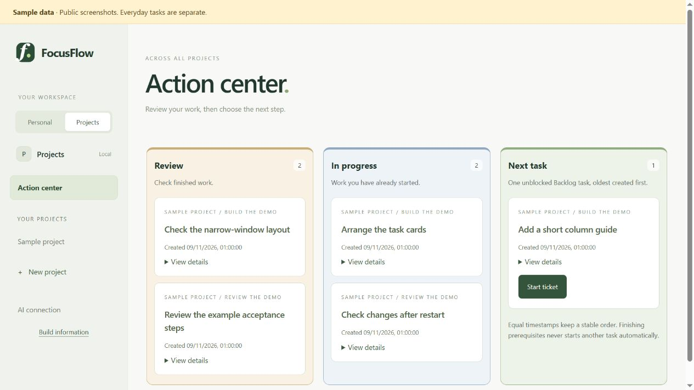
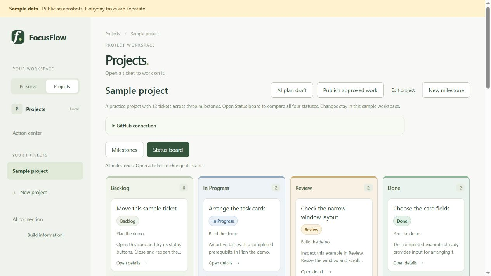
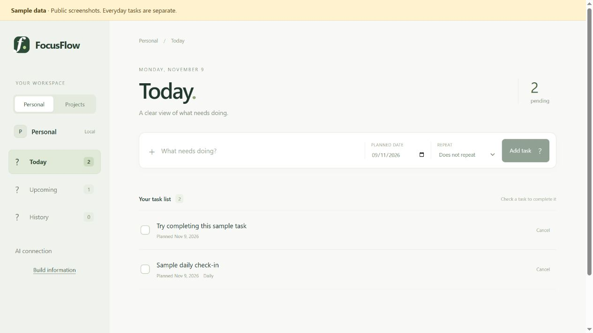

# FocusFlow

A personal Windows tool for daily tasks and projects. Built with TypeScript, React, Electron and SQLite. Single user, local data, no FocusFlow account.

Personal, manual Projects and AI planning/coding/review have source implementations. The newest AI workflow and personal launcher await owner-led local acceptance. Installation packages, signing, public releases and automatic updates are outside scope.

## Open my tasks

Install Git and Node 24.12.x or later in the 24.x series, clone this repository, then double-click **Start-FocusFlow.cmd**.

~~~powershell
git clone https://github.com/gh01wzx/focusflow.git
cd focusflow
.\Start-FocusFlow.cmd
~~~

The command prepares missing source dependencies and the pinned AI runtime, builds source and opens your personal data. It does not run tests, sign in, request a model response or start coding automatically. Personal and manual Projects work without GitHub or Codex sign-in. A failed AI runtime setup leaves local task use available.

Your normal data stays at a fixed location across checkouts and database versions:

~~~text
%LOCALAPPDATA%\FocusFlow\desktop\data\tracker.db
~~~

This reuses the established everyday-data location. A fresh personal profile starts empty; no dummy tasks are added. Existing development/review data is retained separately and never automatically imported, moved or reset.

## Try sample data

Use the same command with an optional review name:

~~~powershell
.\Start-FocusFlow.cmd --review local-try
~~~

This opens separate examples, including 12 manual project tickets, blockers and a saved practice AI plan. Reopen the same name to keep sample edits; a new name starts fresh examples. Review data is separated by schema version. It never copies personal tasks. The lower-level npm start command still opens developer sample data.

*Screenshots show the shared interface with synthetic data. The personal profile starts empty.*

## Features in source

| Area | What you can do |
| --- | --- |
| Personal | Add dated tasks, complete/cancel them, browse Today, Upcoming and History |
| Repeating tasks | Repeat daily or on selected weekdays; retain missed periods without overdue accumulation |
| Projects | Organize projects, milestones and tickets with descriptions and acceptance steps |
| Progress | Use Backlog, In Progress, Review and Done; see linked prerequisites and manual blocker reasons |
| Action center | Review work, see active tickets and explicitly choose one eligible task |
| AI planning | Generate, edit, select and explicitly approve a local plan |
| GitHub | Confirm a repository, preview coding Issues before publication and compare linked requirements |
| Coding | Prepare a separate Git worktree, start one ticket, decide on permissions, stop and recover saved work |
| PR review | Publish one linked PR, inspect diff/check evidence, ask AI code questions and request revisions |
| Completion | Merge explicitly on GitHub; an observed matching merge makes the coding ticket Done |
| Local data | Retain tasks, take verified snapshots before migrations and restore to a separate path |

New AI execution/review code is untested. Missing checks are displayed as missing; AI answers are inferences, not proof of correctness. Coding drafts cannot start until published. A closed Issue or unmerged PR does not make a coding ticket Done. No next task starts automatically.

## Use Personal and Projects

Temporary tasks stay pending until resolved and retain their original planned date. Repeats follow the computer's local date; unfinished periods become Missed in History without accumulating overdue copies. Older weekly schedules retain their original seven-day periods.

For a manual project, create a milestone and a few tickets, link prerequisites, then use Action center to start the first unblocked ticket. Move it through Review to Done and explicitly start the next one. Blocked is a notice with links and a manual reason, not a fifth status.

[Detailed usage and coding/review steps](docs/USAGE.md).

## Optional AI and GitHub

AI planning sends the entered goal. Coding operates on the selected ticket worktree. Review sends bounded PR code/diff/check evidence and the question. Each model request requires explicit consent and uses ChatGPT Codex allowance; API-key billing is refused.

Approved publication sends previewed ticket/source content to the selected repository. GitHub credentials stay in the profile's Windows-encrypted vault and are not attached to coding/review prompts. Live account, sandbox and cancellation behavior still need owner acceptance.

[AI setup](docs/DEVELOPMENT.md#ai-account-setup-and-validation) | [GitHub connection](docs/GITHUB_CONNECTION.md).

## Data and maintenance

Existing data changes format only after a verified pre-change snapshot. Failed migration rolls back. Preserve the current database and use a compatible snapshot at a separate target for recovery; never overwrite the only current copy. Personal data, credentials and raw execution logs do not belong in Git.

Keep your checkout current through Git when you choose. There is no installer, release channel or in-app updater in the personal-use workflow.

The owner requested implementation before unified local testing. No test suite, native app, model or installer was run for this delivery. Workflows remain manual-only; historical evidence does not verify newly changed code.

[Data paths and recovery](docs/DEVELOPMENT.md#data-paths) | [Architecture](docs/ARCHITECTURE.md) | [Validation limits](docs/VALIDATION.md) | [Product scope](docs/PRODUCT_BASELINE.md) | [Project progress](https://github.com/gh01wzx/focusflow/issues/28).
